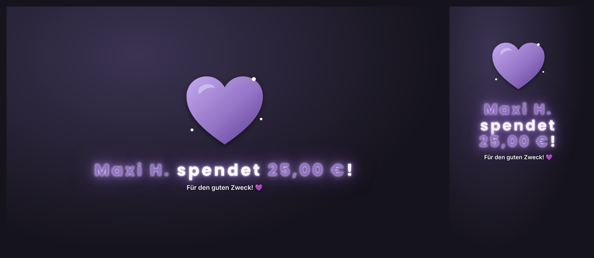
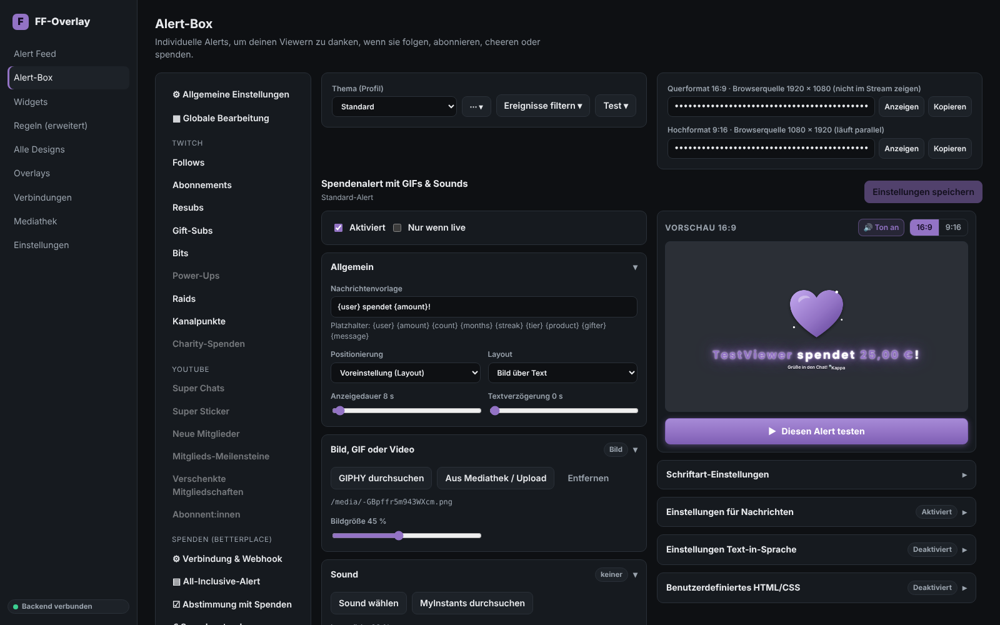
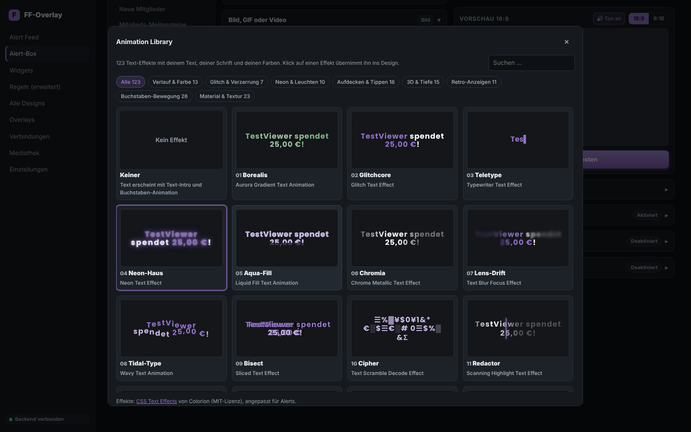
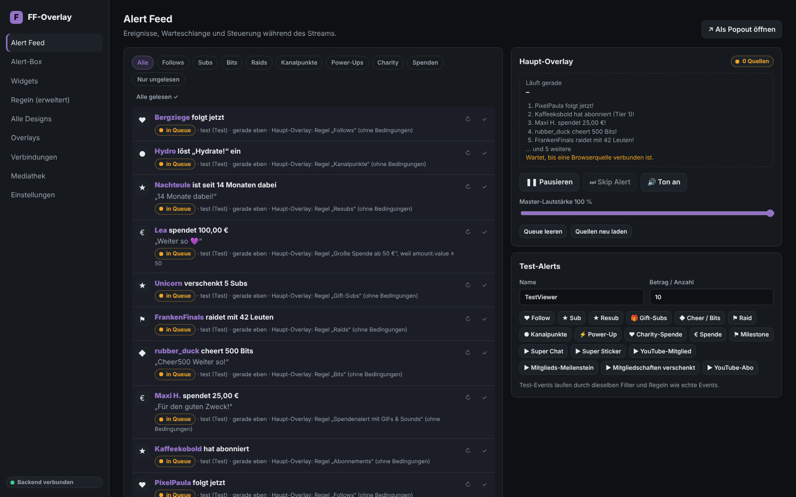
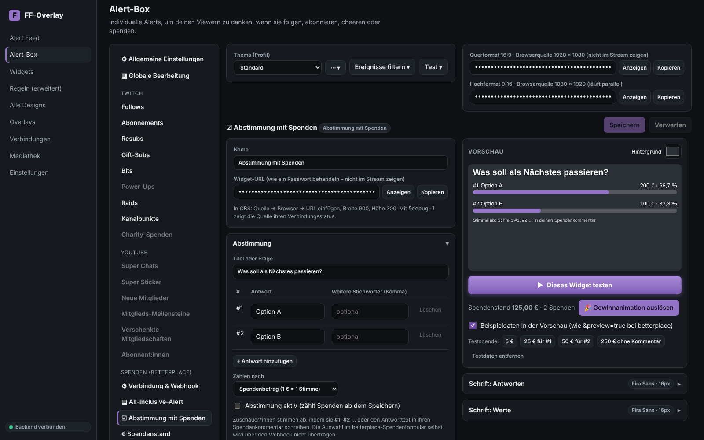
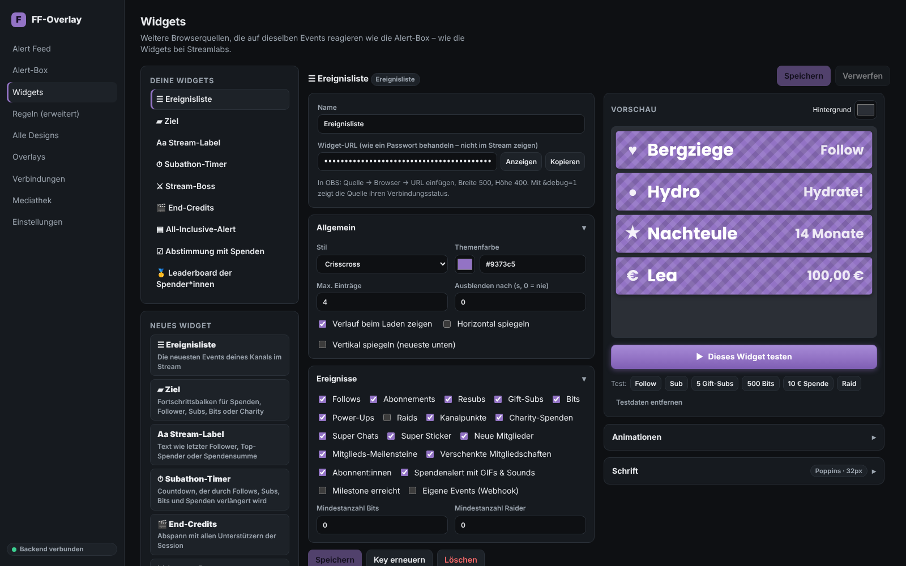
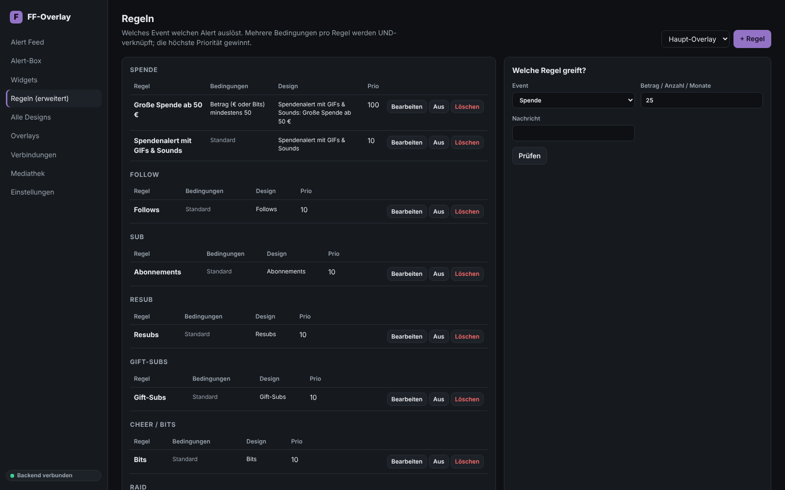
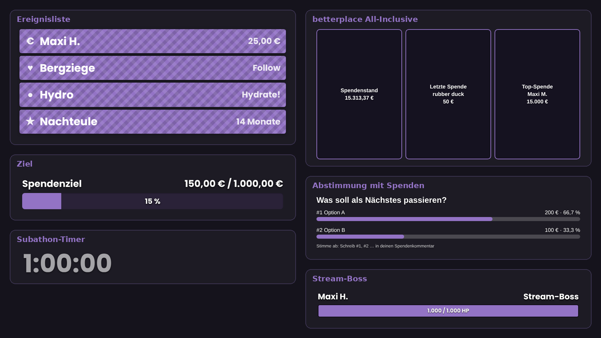
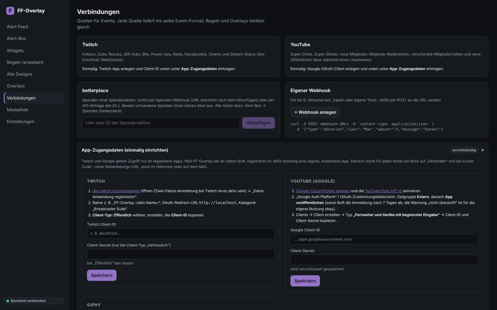

<div align="center">

# FF-Overlay

**Selbst gehostetes Stream-Alert-System für Twitch, YouTube und betterplace**

Alerts, Widgets und Spenden-Overlays wie bei Streamlabs oder StreamElements, aber auf deinem eigenen Rechner oder NAS.
Ohne Cloud-Konto und ohne Abo, und deine Daten bleiben bei dir.




<sub>Ein Spenden-Alert läuft gleichzeitig im Querformat (16:9) und im Hochformat (9:16), hier mit dem Text-Effekt „Neon-Haus“ aus der Animation Library.</sub>

</div>

---

## Inhalt

- [Was ist FF-Overlay?](#was-ist-ff-overlay)
- [Screenshots](#screenshots)
- [Funktionen](#funktionen)
- [So funktioniert es](#so-funktioniert-es)
- [Schnellstart](#schnellstart)
- [Einrichtung](#einrichtung)
- [Konfiguration](#konfiguration)
- [Sicherheit & Datenschutz](#sicherheit--datenschutz)
- [Entwicklung](#entwicklung)
- [Roadmap](#roadmap)
- [Drittanbieter](#drittanbieter)

---

## Was ist FF-Overlay?

FF-Overlay empfängt Ereignisse aus deinem Stream: Follows, Subs, Bits, Raids, Super Chats und Spenden.
Eine **Regel-Engine** entscheidet, welcher Alert dazu passt. Der Alert erscheint dann animiert in einer **Browserquelle**,
die du in OBS, Streamlabs Desktop, vMix oder jede andere Software mit Browserquelle einfügst.
Alles Weitere stellst du in einem **Web-Dashboard** ein, das sich an der Bedienung der Streamlabs-Alert-Box orientiert.

**Highlights**

- 🔔 **Alert-Box wie bei Streamlabs:** Standard-Alerts und Varianten pro Event-Typ, Themen, globale Bearbeitung und eine Live-Vorschau mit Ton
- 💜 **betterplace-Integration:** alle Livestream-Alerts und -Widgets von betterplace, per Spenden-Webhook in Echtzeit
- ✨ **Animation Library:** 123 Text-Effekte (Neon, Glitch, Split-Flap, Gold-Foil, Wax-Seal …), die deine Schrift und Farben übernehmen
- 📱 **16:9 und 9:16 parallel:** jeder Alert läuft gleichzeitig quer und hochkant, im Hochformat größer skaliert für TikTok, Shorts und Reels
- 🧩 **Widgets:** Ereignisliste, Ziele, Stream-Labels, Subathon-Timer, End-Credits, Stream-Boss und Spenden-Ticker
- ▶️ **„Diesen Alert testen“:** spielt den gerade bearbeiteten Alert sofort im Overlay ab, auch ungespeichert
- 🏠 **Selbst gehostet:** eine SQLite-Datei, läuft lokal, im Heimnetz oder per Docker auf dem NAS

---

## Screenshots

| Alert-Box | Animation Library |
| :---: | :---: |
| [](docs/screenshots/alert-box.png) | [](docs/screenshots/animation-library.png) |
| Einstellungen links, Live-Vorschau mit Ton und Test-Knopf rechts | 123 Effekte in 8 Kategorien, live mit dem eigenen Text |
| **Alert Feed** | **betterplace: Abstimmung mit Spenden** |
| [](docs/screenshots/alert-feed.png) | [](docs/screenshots/betterplace.png) |
| Event-Log, Warteschlange, Pause, Skip und Test-Alerts | Alle betterplace-Widgets direkt in der Alert-Box |
| **Widgets** | **Regeln** |
| [](docs/screenshots/widgets.png) | [](docs/screenshots/rules.png) |
| Jedes Widget ist eine eigene Browserquelle | Beliebig viele UND-Bedingungen pro Regel und die Prüfung „Welche Regel greift?“ |

<details>
<summary><b>Widgets im Overlay</b> und <b>Verbindungen</b></summary>

<br>





</details>

<sub>Alle Screenshots stammen aus einer Demo-Installation mit Testdaten.</sub>

---

## Funktionen

### Quellen

| Quelle | Events | Anbindung |
| --- | --- | --- |
| **Twitch** | Follow, Sub, Resub (Monate, Streak, Nachricht), Gift-Subs (auch anonym), Bits, Raids, Kanalpunkte, Power-Ups, Charity-Spenden, Stream online/offline | EventSub über WebSocket: funktioniert hinter NAT, ohne öffentlichen Webhook. Anmeldung per Klick und Gerätecode, automatischer Token-Refresh |
| **YouTube** | Super Chats, Super Sticker, neue Mitglieder, Mitglieds-Meilensteine, verschenkte Mitgliedschaften, neue öffentliche Abos, Stream online/offline | Data API v3. Anmeldung per Klick und Gerätecode |
| **betterplace** | Spenden mit Name, Betrag, Kommentar und Video-Link; Spendenstand, Ziel und Logos der Organisationen | Spenden-Webhook (`donation_announced` v0.2) in Echtzeit oder Public API v4 (Polling mit ETag); kommt der erste Webhook an, stellt FF-Overlay automatisch um, ohne doppelte Alerts |
| **Eigene Webhooks** | Alle Event-Typen | JSON per POST, z. B. von Ko-fi, Streamer.bot oder Zapier |

### Alert-Box

- **Aufbau wie bei Streamlabs:** *Allgemeine Einstellungen* und *Globale Bearbeitung*, darunter für jede Plattform jeder Event-Typ mit Standard-Alert und Varianten
- **Varianten:** zufällig mit Häufigkeit, Betrag/Bits/Monate/Streak mindestens oder genau, Abo-Stufe, Anzahl Gift-Subs, anonym, Raid-Größe, Power-Up, Belohnungsname, größte Spende des Streams
- **Themen (Profile):** mehrere komplette Konfigurationen pro Overlay, mit einem Klick umschaltbar
- **Allgemeine Einstellungen:** Alert-Verzögerung, Moderationsverzögerung mit Freigabe im Alert Feed, Alert-Parry (ein neuer Alert unterbricht den laufenden), Schimpfwort-Filter, Sperrliste
- **Globale Bearbeitung:** Schrift, Sound, Animationen, Positionierung oder TTS einmal einstellen und auf alle Alerts anwenden
- **Lila Knopf „Diesen Alert testen“** in jedem Baukasten: spielt genau den bearbeiteten Stand im Overlay ab, auch ungespeichert. Bei Varianten erfüllt das Test-Event automatisch die Bedingung, z. B. „ab 50 €“
- **Live-Vorschau** mit derselben Render-Logik wie im Overlay, umschaltbar zwischen 16:9 und 9:16, mit Ton an/aus

### Alert-Designs

- **Text** mit Platzhaltern `{user}` `{amount}` `{count}` `{months}` `{streak}` `{tier}` `{product}` `{gifter}` `{message}`, Akzentfarbe für Name und Betrag, Kontur, Schatten und Google Fonts
- **Bilder, GIFs und Videos:** GIPHY-Suche (der Key bleibt auf dem Server) oder eigene Uploads (GIF, PNG, WebP, WebM mit Transparenz, MP4)
- **Sounds:** eigene Uploads oder direkt bei **MyInstants** suchen, probehören und übernehmen. Der Sound landet in der eigenen Mediathek
- **Animation Library:** alle 123 Effekte von [text-effects.colorion.co](https://text-effects.colorion.co/). Schrift, Größe, Stärke, Farben, Kontur, Schatten, Emojis und Buchstaben-Animation kommen aus den Alert-Einstellungen; Tempo und Akzentfarben sind einstellbar
- **Ein- und Ausblend-Animationen** (Animate.css), Text-Intro/-Outro und Buchstaben-Animationen (Welle, Hüpfen, Pulsieren …). Sie sind per Haken zuschaltbar, die Animation Library läuft unabhängig davon
- **Layouts:** Bild über, unter oder links vom Text, nur Text, oder frei positionieren in %
- **Text-in-Sprache:** Stimme, Sprache, Mindestbetrag, Spam-Schutz und Wiederholungssperre
- **Twitch-Emotes** in Nachrichten, **eigenes HTML/CSS/JS** in einer abgeschotteten Sandbox

### Spenden mit betterplace

Alle Livestream-Alerts von betterplace stehen in der Alert-Box unter **Spenden (betterplace)**:

- **Spendenalert mit GIFs & Sounds** und **Milestone erreicht**, mit Varianten, GIF, Sound und TTS
- **All-Inclusive-Alert** mit Spendenstand, letzter Spende und Top-Spende (Themes: Standard, Pixel, Sakura, Pride oder eigenes Design)
- **Abstimmung mit Spenden:** Zuschauer*innen stimmen per `#1`, `#2` oder Stichwort im Kommentar ab, gezählt nach Betrag oder Anzahl, mit Gewinnanimation
- **Spendenstand**, **Letzte Spende**, **Top-Spende**, **Leaderboard**, **Fortschrittsbalken**, **Letzter Kommentar**, **Logos der Organisationen**, **Milestones** und **Live Spenden-Feed** (auch als OBS-Dock)
- Test-Modus mit Beispieldaten oder `&preview=true` pro Quelle

### Widgets

Jedes Widget hat eine eigene Browserquellen-URL. Änderungen erscheinen sofort in OBS, ohne dass du die Quelle neu laden musst.

| Widget | Beschreibung |
| --- | --- |
| **Ereignisliste** | Die letzten Events, 10 Stile (Carbon, Chevrons, Honeycomb, Retro …), Filter nach Typ und Mindestwert |
| **Ziel** | Fortschritt für Spenden, Charity, Bits, Follower oder Subs, mit Start- und Enddatum |
| **Stream-Label** | 20 Labels (letzter Follower, Top-Spender, Spendensumme …) für Session, Tag, Woche oder Monat |
| **Subathon-Timer** | Sekunden pro Follow/Sub/Bits/€/Raid, mit Obergrenze; Start, Pause und ± im Dashboard |
| **End-Credits** | Abspann der Session als Klassisch, Weltraum-Crawl oder Sternenhimmel |
| **Stream-Boss** | Zuschauer*innen machen Schaden; wer den Boss besiegt, wird der neue Boss |
| **Spenden-Ticker** | Laufband mit den letzten Spenden und Cheers |

### Regeln

Unter **Regeln (erweitert)** geht FF-Overlay über Streamlabs hinaus:

- Auslöser sind Event-Typ, Subtyp und Plattform. Pro Regel sind beliebig viele UND-Bedingungen möglich: mindestens, höchstens, zwischen, enthält, Regex, *größter Betrag dieses Streams*, *erstes Event dieses Users*, *Zufall in %*
- Bei mehreren passenden Regeln entscheiden Priorität und Gewichtung; „nur wenn live“ ist pro Regel einstellbar
- Das Event-Log nennt die Begründung, z. B. *„Regel ‚Große Spende', weil amount.value ≥ 50“*. Das Werkzeug „Welche Regel greift?“ prüft beliebige Beispiel-Events

### Alert Feed und Live-Steuerung

- Event-Feed mit Filtern, Lesestatus, Replay und Popout-Fenster
- Pro Overlay: Pause, Skip, Stumm, Master-Lautstärke, Queue leeren, Quellen neu laden und eine Anzeige der verbundenen Quellen
- Test-Alerts für jeden Event-Typ, die durch dieselben Filter und Regeln laufen wie echte Events

### Weiteres

- Mehrere Overlays mit eigener URL, Warteschlange und eigenen Regeln
- Gift-Bündelung: die Einzel-Subs der Beschenkten landen nur im Log, der Alert kommt vom Gift-Event
- Das Event-Log wird automatisch nach `EVENT_RETENTION_DAYS` (Standard 30) aufgeräumt

---

## So funktioniert es

```
Twitch EventSub ─┐
YouTube API ─────┤
betterplace ─────┼─► Connectoren ─► Normalisierung ─► Filter ─► Regel-Engine ─► Warteschlange ─► Overlay 16:9
Webhooks ────────┘                                                    │                    └──► Overlay 9:16
                                                                      └──► Widgets (Browserquellen)
                          Dashboard (REST + WebSocket) steuert alles live
```

Jede Quelle liefert Events im **selben Format**. Regeln, Designs und Overlays funktionieren deshalb unabhängig davon,
ob eine Spende von betterplace, von YouTube oder aus einem eigenen Webhook kommt.

---

## Schnellstart

**Voraussetzung:** Node.js ≥ 22 (macOS: `brew install node`)

### Lokal ausprobieren, ein Befehl

```bash
git clone https://github.com/Intracy/FF-Overlay.git
cd FF-Overlay
./scripts/start-local.sh        # oder: npm run local
```

Das Skript legt beim ersten Start eine `.env` an, installiert alles, baut das Projekt und öffnet das Dashboard auf
**http://localhost:3000**, ohne Login. Mit `--dev` startet es den Entwicklungsmodus mit Hot Reload.

Beim ersten Start legt FF-Overlay ein **Haupt-Overlay** mit Standard-Designs und -Regeln an. Unter **Alert Feed → Test-Alerts** kannst du sofort loslegen.

### Docker (z. B. auf dem NAS)

```bash
cp .env.example .env      # APP_SECRET, PUBLIC_URL und ggf. ADMIN_PASSWORD setzen
docker compose up -d --build
```

Datenbank und Uploads liegen in `./data`. Für ein Backup sicherst du diesen Ordner.

### Manuell / Produktion

```bash
cp .env.example .env
npm install
npm run build && NODE_ENV=production npm start    # alles auf Port 3000
```

### Aktualisieren

```bash
git pull && npm install && npm run build    # danach den Server neu starten
```

---

## Einrichtung

<details open>
<summary><b>Overlay in OBS einfügen</b></summary>

1. Dashboard → **Alert-Box** (oder **Overlays**) → URL kopieren. Sie enthält einen geheimen Key, zeige sie nicht im Stream.
2. In OBS: Quelle hinzufügen → **Browser** → URL einfügen, Größe **1920 × 1080**.
3. „Audio über OBS steuern“ aktivieren, damit die Alert-Sounds im Mixer landen.
4. Mit `&debug=1` am Ende der URL zeigt die Quelle ihren Verbindungsstatus.

Ist der Key einmal sichtbar geworden, klicke auf **Key erneuern**. Alte Quellen werden dann sofort getrennt.
</details>

<details>
<summary><b>Querformat (16:9) und Hochformat (9:16) gleichzeitig</b></summary>

Jedes Overlay hat zwei URLs, die synchron laufen (gleiche Warteschlange, gleiche Alerts):

| Format | URL | Browserquelle |
| --- | --- | --- |
| 16:9 | normale URL | 1920 × 1080 |
| 9:16 | URL mit `&format=9x16` | 1080 × 1920, z. B. für die vertikale Leinwand in OBS |

Im Hochformat werden die Alerts größer skaliert (Standard 160 %) und halten Abstand zu den Bedienelementen von TikTok,
Shorts und Reels. Einstellbar unter **Alert-Box → Allgemeine Einstellungen → Hochformat 9:16**.
Liegen beide Quellen in derselben Szene, schaltest du eine mit `&mute=1` stumm, sonst kommt der Sound doppelt.
</details>

<details>
<summary><b>Widgets</b></summary>

Dashboard → **Widgets** → Widget anlegen, einstellen, **Speichern**, URL kopieren und als eigene Browserquelle einfügen.
Die passende Größe steht unter der URL. Für die End-Credits „Quelle beim Ausblenden herunterfahren“ in OBS **aus** lassen.
</details>

<details>
<summary><b>Twitch und YouTube verbinden</b></summary>

Dashboard → **Verbindungen** → „Mit Twitch verbinden“ bzw. „Mit YouTube verbinden“. Es erscheint ein kurzer Code.
Den gibst du auf `twitch.tv/activate` bzw. `google.com/device` ein, auch am Handy. Eine Weiterleitungs-URL ist nicht nötig,
das klappt also auch mit `localhost` oder auf dem NAS.

Einmalig braucht jede Installation eigene, kostenlose App-Zugangsdaten. Du trägst sie unter
**Verbindungen → App-Zugangsdaten** oder in der `.env` ein:

- **Twitch:** [dev.twitch.tv/console/apps](https://dev.twitch.tv/console/apps) → App registrieren (Zwei-Faktor-Anmeldung nötig), Redirect-URL `http://localhost`, **Client-Typ „Öffentlich“**, dann die Client-ID eintragen
- **YouTube:** Google-Cloud-Projekt anlegen, **YouTube Data API v3** aktivieren, OAuth-Zustimmungsbildschirm „Extern“ **veröffentlichen** (im Testmodus läuft die Anmeldung nach 7 Tagen ab), Client vom Typ **„Fernseher und Geräte mit begrenzter Eingabe“** anlegen, dann Client-ID und Secret eintragen

**YouTube-Kontingent:** Super Chats und Mitgliedschaften gibt es nur über den Live-Chat der API. Eine Abfrage kostet
5 von 10.000 Einheiten pro Tag. Bei einer Abfrage alle 8 Sekunden reicht das für gut 4 Stunden Livestream täglich.
Mehr Kontingent kannst du in der Google Cloud Console kostenlos beantragen.

Twitch-Scopes: `moderator:read:followers`, `channel:read:subscriptions`, `bits:read`, `channel:read:redemptions`, `channel:read:charity`.
</details>

<details>
<summary><b>betterplace: Spendenaktion und Webhook</b></summary>

1. Dashboard → **Alert-Box → Spenden (betterplace) → Verbindung & Webhook**: Link oder ID der Spendenaktion einfügen und die Webhook-URL kopieren.
2. Auf betterplace: Spendenaktion → **Alerts für deinen Charity Stream → Spenden-Webhook → Webhook einrichten**, URL einfügen, Webhook **an**, „Testspende senden“.

betterplace ruft die Webhook-Adresse aus dem Internet auf. `PUBLIC_URL` muss dafür öffentlich erreichbar sein, z. B. über
`cloudflared tunnel --url http://localhost:3000` oder einen Reverse-Proxy auf dem NAS. Ohne öffentliche Adresse kommen
Spenden weiterhin über die API-Abfrage an, etwa alle 20 Sekunden.
</details>

<details>
<summary><b>GIPHY</b></summary>

Lege unter [developers.giphy.com](https://developers.giphy.com/dashboard/) einen API- oder SDK-Key an und trage ihn unter
**Verbindungen → App-Zugangsdaten → GIPHY** ein. Dort wird er verschlüsselt gespeichert. Alternativ setzt du ihn als `GIPHY_API_KEY` in der `.env`.
Fehlt der Key, fragt die GIF-Suche direkt danach.
</details>

<details>
<summary><b>Text-in-Sprache</b></summary>

TTS nutzt die Sprachausgabe der Browserquelle (Web Speech API). Welche Stimmen verfügbar sind, hängt vom Rechner ab, auf dem OBS läuft;
macOS und Windows bringen deutsche Stimmen mit. Fehlt die gewählte Stimme, wird die Standardstimme der Sprache genutzt.
</details>

<details>
<summary><b>Eigener Webhook</b></summary>

```bash
curl -X POST "<Webhook-URL aus dem Dashboard>" \
  -H 'content-type: application/json' \
  -d '{"type":"donation","user":"Max","amount":5,"currency":"EUR","message":"Danke!"}'
```

Felder: `type` (follow, subscription, cheer, donation, raid, redemption, custom), `subtype`, `user`, `amount`, `currency`,
`message`, `count`, `months`, `tier`, `product`, optional `id` zum Deduplizieren.
</details>

<details>
<summary><b>Ton in der Vorschau und im Browser-Tab</b></summary>

Die Vorschau im Dashboard spielt den Sound beim Öffnen und nach jeder Änderung an Sound oder Lautstärke einmal mit,
die automatischen Wiederholungen bleiben stumm. Öffnest du das Overlay in einem normalen Browser-Tab statt in OBS,
blockiert der Browser den Ton bis zum ersten Klick. Das Overlay zeigt dann einen Hinweis. OBS braucht das nicht.
</details>

---

## Konfiguration

| Variable | Standard | Bedeutung |
| --- | --- | --- |
| `PUBLIC_URL` | `http://localhost:3000` | Öffentliche Basis-URL für Overlay-, Widget- und Webhook-URLs |
| `ADMIN_PASSWORD` | leer | Passwort fürs Dashboard; leer bedeutet kein Login. **Setzen, sobald das Dashboard von außen erreichbar ist** |
| `APP_SECRET` | – | ≥ 32 Zeichen, Pflicht in Produktion; signiert Cookies und verschlüsselt Tokens (AES-256-GCM) |
| `TWITCH_CLIENT_ID` / `TWITCH_CLIENT_SECRET` | – | Twitch-App (alternativ im Dashboard) |
| `GOOGLE_CLIENT_ID` / `GOOGLE_CLIENT_SECRET` | – | Google-Client für YouTube (alternativ im Dashboard) |
| `GIPHY_API_KEY` | – | GIPHY-Suche (alternativ im Dashboard) |
| `YOUTUBE_CHAT_POLL_SECONDS` | `8` | Mindestabstand der YouTube-Chat-Abfrage |
| `BETTERPLACE_POLL_SECONDS` | `20` | Abfrage-Intervall der betterplace-API (mindestens 15) |
| `EVENT_RETENTION_DAYS` | `30` | Aufbewahrung des Event-Logs |
| `PORT` | `3000` | Port des Servers |
| `DATA_DIR` | `./data` | Datenbank und Uploads |

---

## Sicherheit & Datenschutz

- **Ein geheimer Key pro Overlay und Widget**, jederzeit erneuerbar. Alte Quellen werden dann sofort getrennt
- **Optionaler Dashboard-Login** mit signiertem Cookie und Rate-Limit
- **Verschlüsselte Zugangsdaten:** OAuth-Tokens, Client-Secrets und der GIPHY-Key liegen AES-256-GCM-verschlüsselt in der Datenbank
- **Zuschauertexte werden nur als Text gerendert**, nie als HTML. Eigenes HTML läuft in einer abgeschotteten Sandbox
- **Medien-URLs** sind nur `https://` oder eigene Uploads
- **Keine Cloud:** alle Daten liegen in einer SQLite-Datei in `./data`

---

## Entwicklung

```bash
npm run dev        # Backend :3000 + Dashboard mit Hot Reload :5173
npm test           # Vitest (Engine, Normalisierung, Queue, Widgets, API inkl. WebSocket)
npm run typecheck  # Backend + Frontend
npm run build      # dist/web + dist/server
```

**Technik:** Node.js 22 · TypeScript · Fastify 5 (REST + WebSocket) · better-sqlite3 · zod · React 19 · Vite · Vitest

<details>
<summary><b>Projektstruktur</b></summary>

```
server/src/
  index.ts, app.ts        Start & Fastify-Setup (REST, WebSocket, statische Dateien)
  connectors/             Twitch (OAuth, EventSub), YouTube, betterplace, Webhooks, Gerätecode-Anmeldung
  events/pipeline.ts      Filter → Regel-Engine → Queue, Event-Log, Stream-Session
  rules/engine.ts         Bedingungen, Priorität, Gewichtung, Begründung
  queue/alertQueue.ts     Warteschlange pro Overlay (Pause, Skip, Timeout)
  templates/              Platzhalter → Text-Segmente, Standard-Designs
  widgets/                Berechnung aus dem Event-Log, Live-Updates, Validierung
  routes/                 auth, api, connections, media (GIPHY, MyInstants), widgets, ws
  shared/                 Gemeinsame Typen und Kataloge für Backend, Dashboard und Overlay
  db.ts                   SQLite-Schema, Migrationen und Zugriff
server/test/              Vitest
web/
  dashboard/              React-Dashboard
  overlay/                Browserquelle + gemeinsamer Renderer (auch für die Vorschau)
  widget/                 Browserquelle für alle Widgets
  vendor/                 Drittanbieter (Text-Effekte)
scripts/                  start-local.sh, vendor-text-effects.mjs
docs/screenshots/         Bilder für dieses README
```
</details>

<details>
<summary><b>Architekturentscheidungen</b></summary>

- **SQLite statt PostgreSQL:** ein Nutzer, eine Datei, kein zusätzlicher Dienst. Das passt gut zum Selbsthosten. Ein späterer Wechsel betrifft nur `db.ts`.
- **Widgets rechnen aus dem Event-Log:** Ziele, Labels, Credits und Listen werden bei jeder Änderung neu berechnet. So wird nichts doppelt gezählt, und Testdaten lassen sich sauber entfernen. Nur Timer und Boss haben eigenen Zustand.
- **Warteschlange im Backend:** Pause, Skip und Replay wirken sofort, und mehrere Browserquellen (16:9 und 9:16) bleiben synchron.
- **Twitch per WebSocket statt Webhook:** dafür ist kein öffentlicher HTTPS-Endpunkt nötig.
- **Ein Renderer für Overlay und Vorschau:** das Dashboard zeigt exakt das, was in OBS erscheint.
</details>

---

## Roadmap

- [ ] YouTube-Chat per streamList (schneller und sparsamer), Cloud-Stimmen für TTS
- [ ] Safe Mode gegen Hate-Raids
- [ ] Ausgehende Aktionen, z. B. OBS-Szenenwechsel per obs-websocket
- [ ] Video-Link aus betterplace-Spenden im Alert abspielen
- [ ] Widgets mit Chat-Anschluss: Chat-Box, Emote-Wand, Umfragen, Chat-Highlights

Bewusst nicht übernommen: Facebook/X/TikTok-Events, Merch, Cloudbot und Zuschauer-GIFs vor Spenden (dafür bräuchte es eine eigene Spendenseite).

---

## Drittanbieter

| Komponente | Lizenz | Verwendung |
| --- | --- | --- |
| [CSS Text Effects](https://github.com/ckissi/colorion-text-effects) von Colorion | MIT | Animation Library, angepasst mit `scripts/vendor-text-effects.mjs` (Schrift aus dem Alert, px → em, beliebiger Text, Zeilenumbruch) |
| [Animate.css](https://animate.style/) | Hippocratic License | Ein- und Ausblend-Animationen |
| [GIPHY](https://developers.giphy.com/) | API-Nutzungsbedingungen | GIF-Suche („Powered By GIPHY“ im Picker) |
| [MyInstants](https://www.myinstants.com/) | – | Sound-Suche; übernommene Sounds landen in der eigenen Mediathek |

<div align="center">
<br>
<sub>Gebaut für die <b>FrankenFinals</b> und alle, die ihre Stream-Alerts selbst in der Hand haben wollen 💜</sub>
</div>
